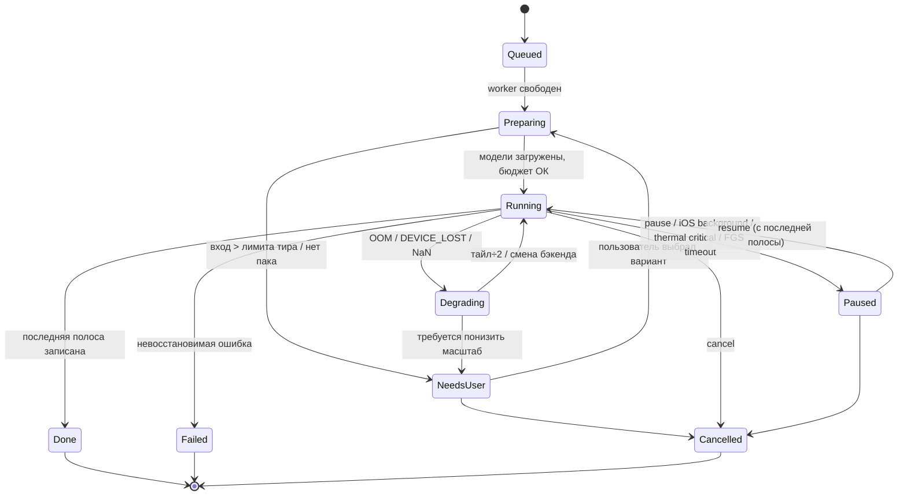
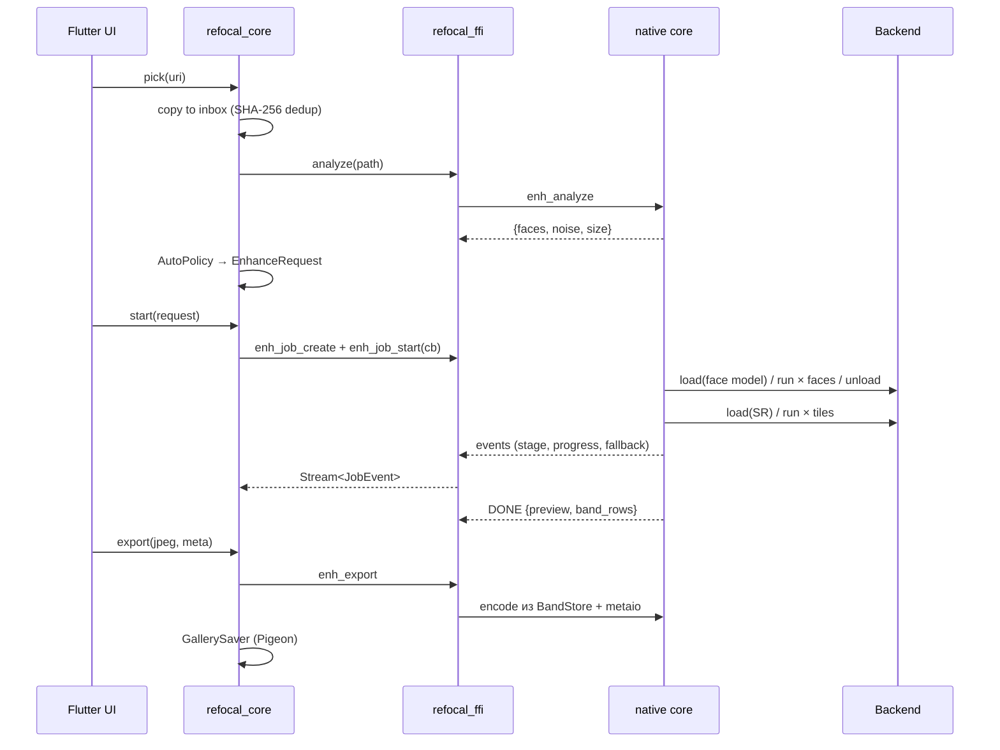
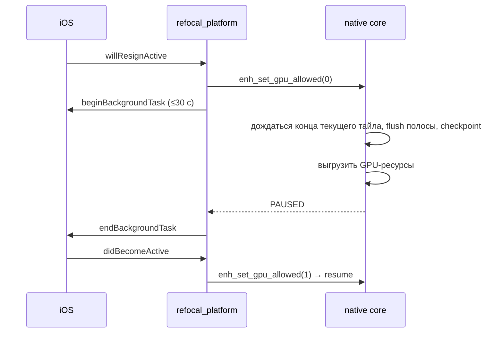

# 03. Архитектура

## 1. Архитектурные драйверы

| Драйвер | Следствие |
|---|---|
| 100% on-device, тяжёлые модели (до 190 МБ, сотни GFLOPs) | Native C++ core, GPU/ANE-бэкенды, тайлинг, строгий бюджет памяти |
| Две платформы, одна команда | Один C++ core для пиксельной логики, один Flutter UI; платформенный код — только тонкие адаптеры |
| Выход до 192 МП не помещается в память | Потоковая обработка полосами, BandStore на диске |
| Нестабильные GPU-драйверы, жёсткие лимиты памяти iOS | Лестница отказов, crash sentinel, тиры, MemoryGovernor |
| iOS запрещает GPU в фоне | Пауза на границе тайла, checkpoint/resume |
| F-Droid, лицензионная чистота | Никаких GMS/проприетарных SDK, свои кодеки/метаданные, permissive-зависимости |

## 2. Слои и компоненты

```
┌──────────────────────────────── Flutter app (app/) ─────────────────────────────────┐
│ UI: Home/History · Editor · CompareViewer (tiled pyramid) · Queue · Models ·        │
│     Settings · Onboarding · About/Licenses                                          │
│ go_router · gen_l10n · Semantics/a11y · ui_kit (дизайн-токены)                      │
├──────────────────────── App state (Riverpod 3 providers) ───────────────────────────┤
│ editorSession(family) · queue · history · presets · modelRegistry · deviceCaps ·    │
│ settings · consent (лицензии паков, предупреждение об ИИ)                           │
├──────────── packages/refocal_core (чистый Dart, без Flutter) ──────────────────────┤
│ EnhanceRequest/Recipe · EnhanceJob · JobEvent · AutoPolicy · TierPolicy ·           │
│ ModelManager (манифест, загрузка, паки) · QueueOrchestrator · Repositories (drift)  │
├─────────────── packages/refocal_ffi ────────────┬─── packages/refocal_platform ───┤
│ ffigen-биндинги · Dart_PostCObject → ReceivePort │ Pigeon: Picker, GallerySaver,    │
│ JSON-кодек запросов/событий · enh_free (out_json)│ ForegroundService (Android),     │
│                                                  │ LifecycleGpuGate (iOS), Thermal, │
│                                                  │ Memory, ShareIntake, Notifications│
├═════════════════ C ABI (enh_*) ══════════════════╪═══ Kotlin / Swift ═══════════════┤
│ native/core (C++20, CMake)                                                          │
│  Session · JobRunner (worker, флаги cancel/pause, checkpoint) · Pipeline (Stages)   │
│  Tiler/Scheduler · Blend (feather, strength) · FaceAlign (FFHQ-512, inverse affine, │
│  маска erode+feather, color match) · Analyze (шум/блюр/JPEG/лица) · MemoryGovernor  │
│  BandStore · Pyramid · DeviceProbe/Benchmark · CrashSentinel · Crypto (Monocypher)  │
│  io/: libjpeg-turbo · libpng · libwebp(+mux) · metaio (EXIF/XMP/ICC) ·              │
│       PlatformCodec ──► AImageDecoder/HeifWriter (JNI) | ImageIO                    │
├──────────────────────── InferenceBackend (C++ интерфейс) ───────────────────────────┤
│ NcnnVulkanBackend │ NcnnCpuBackend │ CoreMLBackend (.mm) │ [R1.4] OrtQnnBackend     │
└─────────────────────────────────────────────────────────────────────────────────────┘
Хранилище: drift SQLite │ AppSupport/models │ AppSupport/jobs/<id> │ AppSupport/inbox │
           AppSupport/history (превью) │ logs/
Сеть (только по действию/согласию): HF / GitHub Releases (манифест, паки) │
           GitHub issue URL
```

### 2.1 Ответственность модулей

| Модуль | Ответственность | Не делает |
|---|---|---|
| `app` | UI, навигация, состояние экранов, l10n, a11y | Не трогает пиксели, не знает про бэкенды |
| `refocal_core` | Доменная модель (рецепт, джоб), политики Auto/Tier, менеджер моделей, очередь, репозитории | Не зависит от Flutter (тестируется `dart test`) |
| `refocal_ffi` | Тонкий мост к `enh.h`, маршалинг JSON, жизненный цикл указателей | Без бизнес-логики |
| `refocal_platform` | Pigeon-интерфейсы к платформенным API | Без обработки изображений |
| `native/core` | Вся обработка: декодирование, пайплайн, тайлинг, лица, кодирование, метаданные, проверка подписей | Без UI, без сети |
| `native/backends` | Реализации `InferenceBackend` | Без знания о пайплайне |
| `ml/` | Python: конверсия, квантизация, оценка, golden-набор, сборка паков и манифеста | Не входит в приложение |
| `tools/refocal-cli` | Desktop CLI из того же core: golden-тесты, perf, воспроизведение багов | — |

## 3. Монорепозиторий

```
/
├── app/                         # Flutter-приложение
│   ├── lib/
│   │   ├── features/{home,editor,compare,queue,history,models,settings,onboarding}/
│   │   ├── router/  l10n/  ui_kit/  bootstrap.dart
│   ├── android/  (flavors: play, fdroid)
│   ├── ios/      (Runner + ShareExtension, PrivacyInfo.xcprivacy)
│   ├── test/  integration_test/
├── packages/
│   ├── refocal_core/           # pure Dart
│   ├── refocal_ffi/            # FFI plugin (CMake/podspec → native/)
│   └── refocal_platform/       # Pigeon
├── native/
│   ├── include/enh.h            # публичный C ABI (эталон: docs/spec/appendix/enh.h)
│   ├── core/{pipeline,io,face,blend,memory,crypto,probe}/
│   ├── backends/{ncnn,coreml,ort_qnn}/
│   ├── third_party/             # git-сабмодули: ncnn, libjpeg-turbo, libpng, libwebp, monocypher, lz4, json
│   ├── tests/  fuzz/
│   └── CMakeLists.txt
├── tools/refocal-cli/
├── tools/rebuilder/             # Docker: закреплённый Android-тулчейн, проверка воспроизводимости (S8)
├── ml/
│   ├── convert/  quantize/  eval/  golden/  packs/
│   ├── MODELS.md  requirements.lock
├── fastlane/metadata/{android,ios}/
├── docs/spec/ ...
├── .github/workflows/ ISSUE_TEMPLATE/
├── flutter/                     # git-сабмодуль Flutter SDK (воспроизводимость)
├── pubspec.yaml  analysis_options.yaml   # pub workspace: app + packages, общий pubspec.lock
└── LICENSE NOTICE CHANGELOG.md CONTRIBUTING.md CODE_OF_CONDUCT.md SECURITY.md PRIVACY.md MODELS.md
```

## 4. Интерфейсы

### 4.1 Dart-доменная модель (`refocal_core`)

```dart
enum EnhanceMode { auto, upscale, faceRestore, denoise, oldPhoto, lowLight, anime }
enum Region { face, background, both }
enum OutputFormat { jpeg, png, webp, heic }

@freezed
class EnhanceRequest {            // = Recipe; сериализуется в историю и пресеты
  const factory EnhanceRequest({
    required int schemaVersion,
    required String inputPath,      // путь в inbox
    required EnhanceMode mode,
    required int scale,             // 1 | 2 | 4 | 8
    required String srModelId,      // "<pack>@<version>"
    String? faceModelId,
    @Default(1.0) double strength,       // 0..1
    @Default(0.5) double faceStrength,   // 0..1
    double? codeformerFidelity,          // 0..1
    @Default(0.5) double denoise,        // 0 | 0.5 | 1
    @Default(Region.both) Region region,
    @Default({}) Map<int, bool> perFace,
    @Default(true) bool colorMatchFaces,
    required OutputSpec output,
    required MetadataPolicy meta,
  }) = _EnhanceRequest;
}

sealed class JobEvent {}
class StageEvent    extends JobEvent { final Stage stage; }
class ProgressEvent extends JobEvent { final int done, total; final Duration? eta; }
class FallbackEvent extends JobEvent { final String from, to, reason; }
class WarningEvent  extends JobEvent { final String code; }
class DoneEvent     extends JobEvent { final ResultBundle result; }
class FailedEvent   extends JobEvent { final EnhError code; final String message; }

abstract interface class RefocalEngine {
  Future<DeviceCaps> probe();
  Future<BenchResult> benchmark();
  Future<AnalyzeResult> analyze(String path);
  EnhanceJob start(EnhanceRequest r);
  Future<EnhanceJob?> resumeFrom(String jobDir);
  Future<ExportResult> export(ResultBundle b, OutputSpec o, MetadataPolicy m, String dst);
}
```

### 4.2 C ABI

Эталон — [appendix/enh.h](appendix/enh.h). Принципы:

- плоский C, только POD и строки; структуры с полем `struct_size` для совместимости;
- сложные параметры — JSON (запрос, события, результаты), схема версионирована (`"schema": 1`);
- все вызовы, кроме `enh_job_start`, синхронные и быстрые; тяжёлая работа — на worker-потоке core;
- строки, которые core возвращает через `out_json`, освобождаются только через `enh_free`; события в Dart идут через native port, VM их копирует, освобождать нечего (ADR-0005);
- коды ошибок — `enh_status` (`int32_t`, не enum), текст — в JSON-событии `ENH_EV_ERROR`; неизвестный код в Dart означает `internal`;
- все строки — валидный UTF-8.

### 4.3 C++ интерфейсы

```cpp
class InferenceBackend {
 public:
  virtual ~InferenceBackend() = default;
  virtual BackendKind kind() const = 0;
  virtual Status load(const ModelSpec&, const LoadOptions&) = 0;   // компиляция/кэш
  virtual std::vector<TileShape> supportedTiles() const = 0;       // CoreML: enumerated
  virtual MemEstimate estimate(const TileShape&) const = 0;
  virtual Status run(std::span<const NamedTensor> in,
                     std::span<NamedTensor> out, const RunOptions&) = 0;
  virtual void unload() = 0;
};

class Stage {
 public:
  virtual StageId id() const = 0;
  virtual MemEstimate estimate(const JobCtx&) const = 0;
  virtual Status run(JobCtx&) = 0;
  virtual bool resumable() const { return false; }
};

class PlatformCodec {        // реализуется на Android (JNI) и iOS (ImageIO)
 public:
  virtual bool canDecode(std::string_view mime) const = 0;
  virtual Status decode(const fs::path&, ImageSink&) = 0;
  virtual bool canEncode(OutputFormat) const = 0;
  virtual Status encode(BandSource&, const EncodeOptions&, const fs::path&) = 0;
};
```

## 5. Модель потоков

| Поток | Владелец | Работа |
|---|---|---|
| Flutter UI (main isolate) | Flutter | UI, провайдеры, приём событий |
| Платформенный main | ОС | Pigeon-вызовы, жизненный цикл |
| `enh-worker` | native core | Один активный джоб: стадии, оркестрация |
| `enh-prep` / `enh-post` | native core | Подготовка тайлов (CPU) и бленд/запись полос |
| GPU-очередь | бэкенд | Инференс (Vulkan queue / Core ML) |
| `enh-io` | native core | Запись BandStore, тайлы просмотра по запросу (`enh_viewer_*`), загрузка паков (Dart HTTP) — отдельно |

- Внутри джоба — конвейер `prep → infer → post`, очереди глубиной 2 тайла.
- Одновременно выполняется **один** GPU-джоб; очередь сериализуется в `QueueOrchestrator`.
- Отмена/пауза — атомарные флаги, проверяются на границе тайла.
- События в Dart — `Dart_PostCObject` в native port сессии (асинхронно, в event loop изолята), без указателей через границу. Канал переживает смерть изолята, к джобу можно подключиться заново (ADR-0005, S6).
- Завершение джоба: `cancel` → терминальное событие → `destroy`. `destroy` работающего джоба блокирует поток до конца тайла.
- Dart-изоляты для обработки пикселей **не используются** (ADR-0006).

## 6. Жизненный цикл джоба



Состояние хранится в drift (`queue_jobs`) и в `jobs/<id>/checkpoint.json`. При старте приложения джобы в `Running`/`Paused` переводятся в `Paused` с предложением продолжить.

## 7. Ключевые сценарии (sequence)

### 7.1 Обработка одного фото



### 7.2 Уход в фон на iOS



### 7.3 Загрузка модельного пака

1. Пользователь нажимает «Скачать» → если `license.requires_acceptance` — диалог лицензии, запись в `consents`.
2. `ModelManager` получает `manifest.json` и `manifest.json.minisig` (HF → зеркало).
3. `enh_verify_minisign` с закреплёнными ключами; проверка `serial ≥ сохранённого`.
4. Скачивание файла под платформу/бэкенд с HTTP Range в `models/.partial/`.
5. `enh_verify_file` (SHA-256) → атомарный rename в `models/<id>@<ver>/`.
6. Регистрация в `model_packs`, инвалидация кэша бенчмарка для этой модели.

### 7.4 Share intake

- **Android:** `ACTION_SEND` → `MainActivity` → Pigeon `ShareIntake.onReceived(uris)` → копия в inbox → `go_router` `/import`.
- **iOS:** Share Extension копирует файл в App Group-контейнер → открывает приложение по URL-схеме `refocal://import?id=…` → основное приложение забирает файл в inbox.

## 8. DeviceCaps и тиры

`enh_device_probe` возвращает: RAM, SoC (`Build.SOC_MODEL` / `hw.machine`), GPU-вендор/драйвер (Vulkan properties), версию Core ML/чип, свободное место, поддерживаемые кодеки. `TierPolicy` (Dart) комбинирует статические правила и результаты бенчмарка — см. [05 §6](05-inference-optimization.md#6-тиры-устройств), ADR-0017.

## 9. MemoryGovernor

- Бюджет: `B = min(tier_cap, os_available × 0.6)`; iOS — `os_proc_available_memory()` перед каждым джобом и стадией; Android — `ActivityManager.MemoryInfo.availMem` (через Pigeon при старте джоба) + `mallinfo` в core.
- Каждая стадия декларирует `estimate()`; при превышении — уменьшение тайла до вызова стадии.
- `enh_set_memory_pressure(level)` от `onTrimMemory` / `didReceiveMemoryWarning` → следующий тайл ÷2.

## 10. CrashSentinel

Перед загрузкой модели на GPU пишется `sentinel.json {driver, model, backend, tile}`; после успешного завершения стадии удаляется. Если при старте процесса файл существует — предыдущий запуск упал в нативном GPU-коде: пара (драйвер, модель) вносится в локальный blocklist, пользователь видит объяснение. Подробно — ADR-0016.

## 11. Хранилище

Детали — [07](07-data-storage-privacy.md). Кратко:

| Путь | Содержимое |
|---|---|
| `AppSupport/db.sqlite` | drift, без бэкапа: история, очередь, паки, согласия, бенчмарк |
| `prefs.sqlite` (каталог с бэкапом) | drift: настройки, пользовательские пресеты (PRIV-DATA-005) |
| `AppSupport/models/<id>@<ver>/` | файлы моделей + `pack.json` |
| `AppSupport/jobs/<id>/` | `bands/`, `checkpoint.json`, `result.json`, `preview.jpg` (тайлы CompareViewer не хранятся: `enh_viewer_render` читает строки полос по запросу — поправка 2026-10-16, 0.3) |
| `AppSupport/inbox/` | копии входных файлов (квота) |
| `AppSupport/history/` | превью истории ≤ 512 px (не `Cache/`: запись живёт дольше кэша) |
| `AppSupport/logs/` | ротируемый лог ≤ 5 МБ |

## 12. Флейворы сборки

| Флейвор | Отличия |
|---|---|
| Android `play` | Метаданные и подпись для Google Play (если публикуется, Q-06) |
| Android `fdroid` | Без `ModuleDependencies` GMS в манифесте, воспроизводимая сборка |

Общее для Android: ABI arm64-v8a (+ x86_64 вне release, для эмулятора и CI; Q-03). `disable-abi-filtering=true` нужен, иначе Flutter Gradle plugin подменяет список ABI. В release выключен `vcsInfo`: AGP иначе пишет git-ревизию в APK (S8).
| iOS | Один таргет + Share Extension |

INTERNET-разрешение присутствует во всех флейворах (скачивание паков), но сетевые вызовы — только по действию пользователя (ADR-0020).

## 13. Связанные ADR

| ADR | Тема |
|---|---|
| [0001](adr/ADR-0001-inference-backends.md) | Бэкенды инференса |
| [0002](adr/ADR-0002-shared-native-core.md) | Общий C++ core и refocal-cli |
| [0003](adr/ADR-0003-image-codecs.md) | Кодеки, HEIC |
| [0004](adr/ADR-0004-bandstore.md) | BandStore |
| [0005](adr/ADR-0005-dart-native-bridge.md) | Мост Dart↔native |
| [0006](adr/ADR-0006-threading.md) | Потоки |
| [0007](adr/ADR-0007-state-management.md) | Riverpod |
| [0008](adr/ADR-0008-navigation.md) | go_router |
| [0009](adr/ADR-0009-persistence.md) | drift |
| [0010](adr/ADR-0010-input-pickers-inbox.md) | Пикеры и inbox |
| [0011](adr/ADR-0011-model-packs.md) | Модельные паки и манифест |
| [0012](adr/ADR-0012-pipeline.md) | Пайплайн |
| [0013](adr/ADR-0013-color.md) | Цвет |
| [0014](adr/ADR-0014-scales.md) | Масштабы |
| [0015](adr/ADR-0015-denoise-levels.md) | Уровни денойза |
| [0016](adr/ADR-0016-fallback-crash-sentinel.md) | Лестница отказов, sentinel |
| [0017](adr/ADR-0017-device-tiers.md) | Тиры устройств |
| [0018](adr/ADR-0018-metadata-ai-marking.md) | Метаданные и AI-маркировка |
| [0019](adr/ADR-0019-background-execution.md) | Фоновое выполнение |
| [0020](adr/ADR-0020-flavors-telemetry.md) | Флейворы и телеметрия |
| [0021](adr/ADR-0021-native-crypto.md) | Криптография в native |
| [0022](adr/ADR-0022-face-models-licensing-defaults.md) | Face-модели: лицензии и умолчания |
| [0023](adr/ADR-0023-gfpgan-mobile-graph-rewrite.md) | Перезапись графа StyleGAN2-моделей для мобильных |
